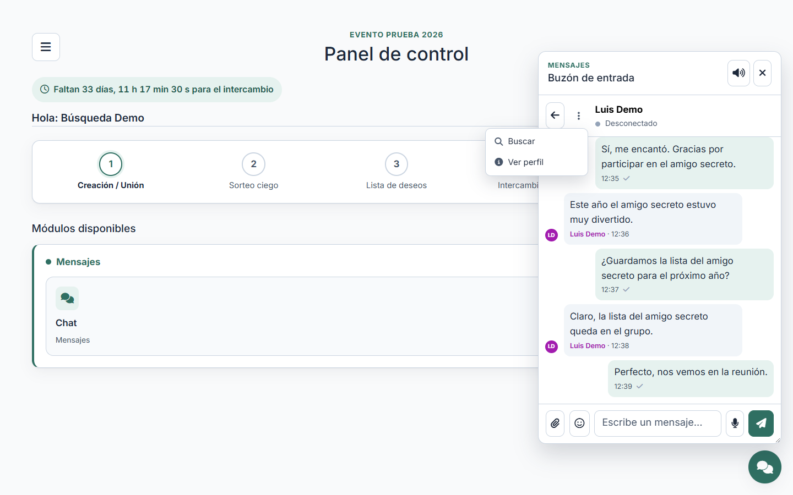
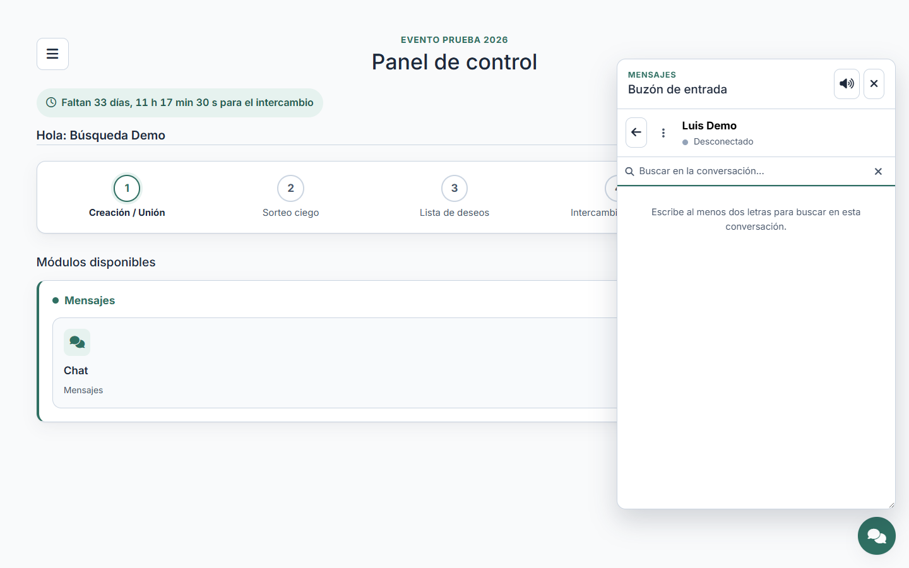
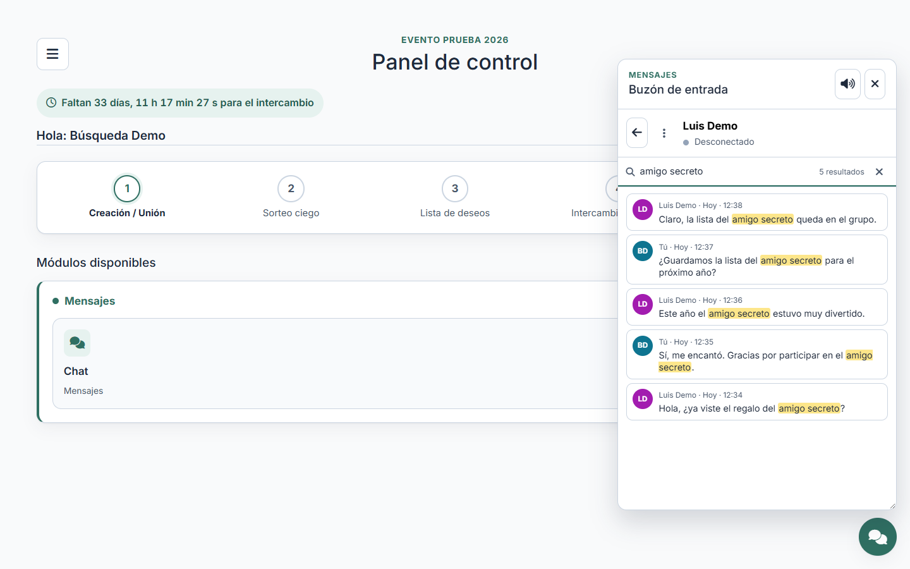
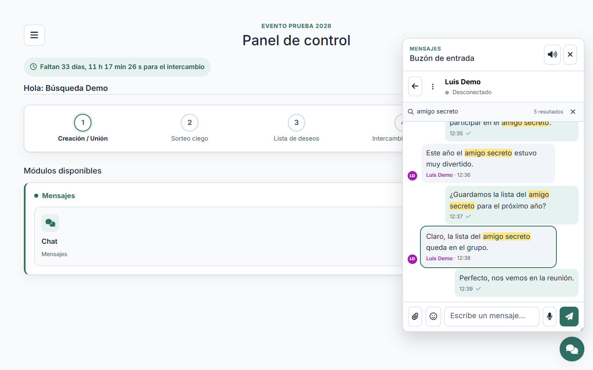

# Buscar en el chat

La conversación tiene una barra de búsqueda debajo de la cabecera. Se abre
desde el menú del botón **⋮** y busca en todo el historial, no solo en los
mensajes que están cargados en pantalla. La **X** limpia el texto, quita el
resaltado y cierra la barra.

## Abrir la búsqueda

1. Entra a una conversación, grupo, chat de amigo secreto o sala de moderación.
2. Pulsa **⋮** en la cabecera.
3. Elige **Buscar**.

   

La barra queda justo debajo de la cabecera, con el campo de texto, el contador
de resultados y la **X**. Mientras está abierta, los resultados ocupan el sitio
de los mensajes y el cuadro de escritura se oculta.

## Mientras escribes

- Se consulta a partir de **dos letras**, con una pausa corta para no lanzar una
  petición por cada tecla.
- El término aparece **resaltado** en cada resultado, junto al remitente, la
  fecha y la hora.
- El contador indica cuántas coincidencias hay. Si hay más de 50, se muestran
  las 50 más recientes y se avisa en el pie.
- Se busca el texto de los mensajes, el nombre de los adjuntos y el título de
  los enlaces compartidos.

## Abrir un resultado

Pulsa una fila para saltar al mensaje:

- Si la burbuja ya está cargada, se desplaza hasta ella y se resalta el término
  dentro de la conversación.
- Si es historial anterior, se carga una **ventana de contexto** (hasta 40
  mensajes antes y 40 después) y se abre en el mensaje encontrado. Al cerrar la
  búsqueda se vuelve al final de la conversación.
- Mientras la búsqueda está abierta no se sondea el historial: así una respuesta
  incremental no pisa la ventana del mensaje abierto.

## Cerrar y limpiar

- La **X** de la barra limpia el texto, quita el resaltado y cierra la búsqueda.
- **Escape** hace lo mismo.
- Al cerrar, la conversación vuelve a mostrarse; si se había abierto un mensaje
  antiguo, se recarga el tramo final.

## Qué respeta

- **Lo vaciado de mi lado:** un mensaje anterior al vaciado no reaparece en la
  búsqueda, aunque siga existiendo para la otra persona.
- **Mensajes eliminados:** no se devuelven ni se muestran en los resultados.
- **Permisos:** solo participantes y administradores con acceso a la conversación
  pueden buscar. Los chats de caso siguen siendo privados para el beneficiario y
  el administrador que tomó el caso.
- **Solo lectura:** se puede buscar y abrir resultados; no se habilita la
  escritura.

## Datos

- `GET /chat/{conversation}/buscar?q=término`: devuelve `items`, `total` y
  `limited`. El mínimo son dos caracteres y el máximo 50 resultados.
- `GET /chat/{conversation}/mensajes?focus_id={id}`: ventana de contexto
  centrada en un mensaje, con los datos de la conversación para pintarla.
- La barra usa `#chat-search`, `#chat-search-input`, `#chat-search-close` y
  `#chat-search-results`; el menú es `#chat-more-menu`.

## Pruebas

- `tests/Feature/ChatTest.php`:
  - `test_el_chat_incluye_la_barra_de_busqueda_y_el_menu_del_boton`
  - `test_la_busqueda_del_chat_encuentra_texto_en_todo_el_historial`
  - `test_la_busqueda_respeta_lo_vaciado_y_solo_entra_quien_participa`
  - `test_la_ventana_de_contexto_abre_un_mensaje_fuera_del_historial_reciente`
