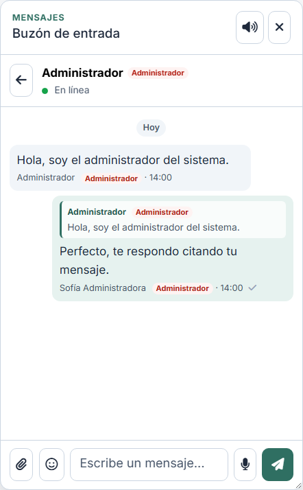

# Etiqueta de «Administrador» en el chat

Junto al nombre de las personas con **rol de administrador del sistema** se
muestra una etiqueta roja «Administrador». Aparece en:

- la línea de autor de cada burbuja: `Nombre [Administrador] · 14:00`;
- la barra del nombre de la conversación (encabezado del chat);
- la cita dentro de una respuesta, cuando el mensaje citado es del
  administrador.

*En la captura el administrador se llama literalmente «Administrador», por eso
el nombre y la etiqueta coinciden.*

## Reglas

- Es el **rol del sistema** (`users.role = admin`), no el papel dentro del grupo
  (dueño/moderador) ni la etiqueta de una mención `@usuario`.
- Un mensaje de moderación ya se rotula «Moderación»: no lleva la etiqueta.
- En el **amigo secreto** no se muestra: revelaría quién es.
- En la barra del chat solo aplica a conversaciones directas; en un grupo el
  título es el del grupo.

## Datos

- `sender_is_admin` en el payload de cada mensaje.
- `reply.sender_is_admin` en la cita de una respuesta.
- `other_is_admin` en los datos de la conversación (barra del chat).
