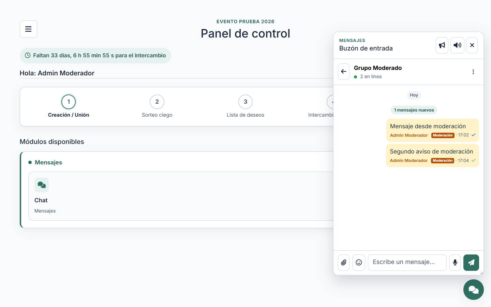
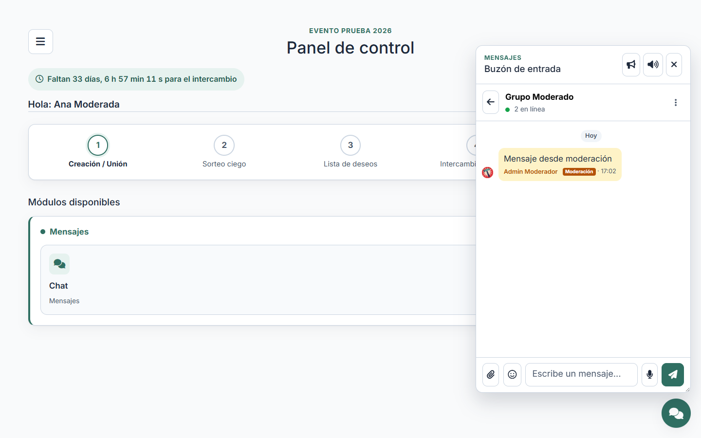

# Mensajes de moderación

Cuando la administración escribe desde la pestaña **Moderación**, el mensaje
viaja marcado con `moderation=1`. El servidor solo acepta esa marca si quien
envía es administrador.

Los mensajes de moderación se ven igual para el remitente y para el
destinatario:

- burbuja **amarilla**;
- etiqueta **Moderación**;
- **nombre real del moderador en dorado**.

Si el administrador escribe desde el chat normal —por ejemplo, porque es
miembro del grupo— el mensaje no se marca como moderación: conserva el nombre
del administrador y su etiqueta de administrador.

## Datos

- `chat_messages.is_moderation`: mensaje escrito en modo moderación.
- `POST /chat/{conversation}/mensajes` acepta `moderation=1`; solo tiene efecto
  para administradores.
- El mensaje expone `sender` con el nombre real del moderador,
  `is_moderation = true` y `sender_is_admin = false` para no duplicar la
  etiqueta de administrador.

## Pruebas

- `tests/Feature/ChatTest.php`: un administrador miembro puede escribir en modo
  moderación; el destinatario recibe la marca; sin la marca el mensaje es
  normal; un participante no puede activar la moderación.
