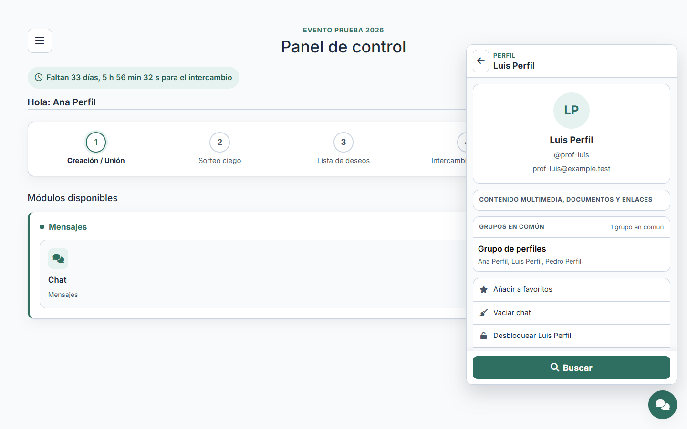
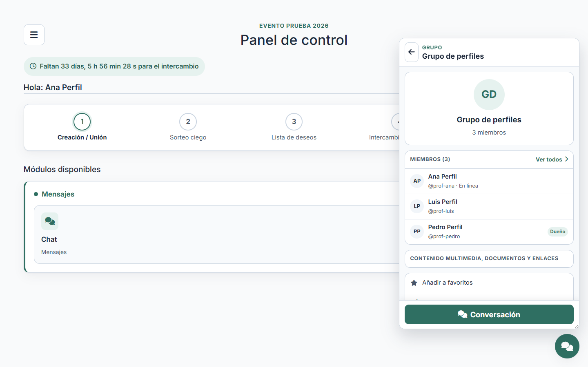
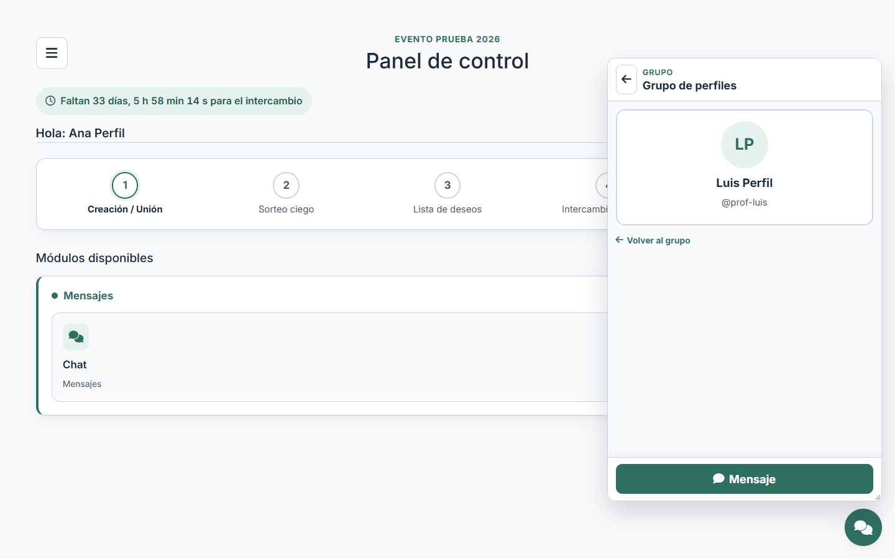
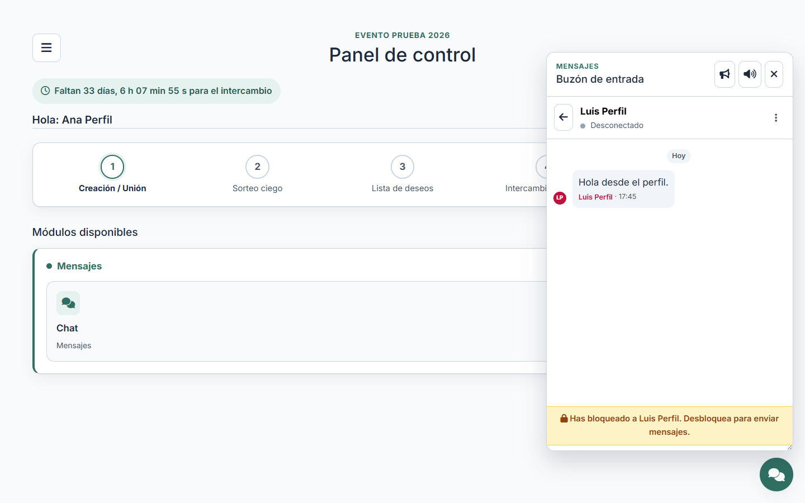
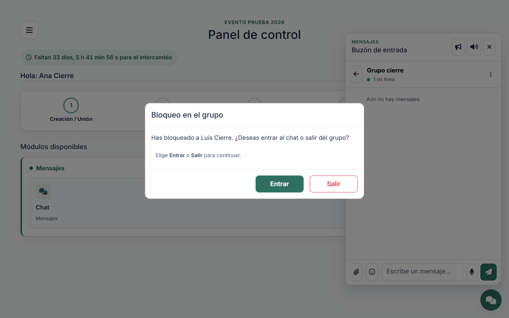

# Perfiles y bloqueos del chat

## Acción principal del perfil

El perfil tiene una acción principal fija al final, según cómo se abrió:

| Contexto | Acción | Qué hace |
| --- | --- | --- |
| Perfil abierto dentro de una conversación, grupo, sala o difusión | **Buscar** | Abre la búsqueda de esa conversación. |
| Perfil abierto desde la bandeja, grupo, sala o difusión | **Conversación** | Entra al grupo, sala o difusión. |
| Perfil de una persona desde la bandeja o la pestaña Usuarios | **Mensaje** | Abre el chat directo con esa persona. |
| Perfil de un miembro dentro de un grupo o sala | **Mensaje** | Abre el chat directo con ese miembro. |

El perfil se abre **directamente**, sin abrir primero el mensaje. El mensaje
solo se abre al pulsar **Mensaje** o **Conversación**.

También se añadió **Ver perfil** al menú contextual de las conversaciones,
grupos, salas y difusiones.

## Bloqueos en chats directos

Un chat directo con bloqueo **se puede abrir y leer**, pero el cuadro de
escritura queda bloqueado con un aviso:

- Si yo bloqueé a la persona: **«Has bloqueado a [nombre]. Desbloquea para
  enviar mensajes.»**
- Si la otra persona me bloqueó: **«[nombre] te ha bloqueado. No puedes
  enviarle mensajes.»**
- Si hay bloqueo mutuo, se avisa de ambas cosas.

El bloqueo se aplica tanto en la interfaz como en `POST /chat/{conversation}/mensajes`.

## Listas para agregar personas

Una persona bloqueada, o que me bloqueó, **no aparece** en las listas para:

- crear un grupo;
- crear una sala;
- agregar un miembro a una sala;
- crear una difusión.

El servidor también rechaza esas operaciones aunque se intente por API.

## Bloqueos dentro de grupos, salas y difusiones

- Si el **dueño** bloquea a un miembro, el miembro es vetado y expulsado del
  grupo o de la sala.
- Si el **miembro** bloquea al dueño, el miembro también es expulsado.
- En una **difusión**, el destinatario bloqueado sale de la lista de
  destinatarios.
- Si el bloqueo es entre dos miembros que **no son el dueño**, ambos permanecen
  en el grupo o sala. Al abrir el chat se muestra el aviso:

  > Has bloqueado a [usuario] / [usuario] te ha bloqueado. ¿Deseas entrar al
  > chat o salir del grupo?

  La persona puede entrar o salir; nadie la expulsa automáticamente. El aviso
  no se puede cerrar con la X, Escape ni tocando fuera: hay que elegir
  **Entrar** o **Salir** para que no quede en un estado intermedio.

Al desbloquear se retiran los vetos automáticos por bloqueo, para que la
persona pueda volver a ser agregada.

## Pruebas

`tests/Feature/ChatTest.php` cubre:

- abrir y leer un chat bloqueado, pero no escribir;
- mensajes específicos según quién bloqueó;
- bloqueo entre dueño y miembro con expulsión de grupo y sala;
- bloqueo del miembro hacia el dueño;
- salida de un destinatario de una difusión;
- rechazo de personas bloqueadas al crear grupos, salas, difusiones y agregar
  miembros;
- aviso de bloqueo entre miembros sin expulsión.
