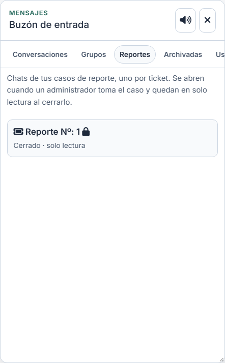
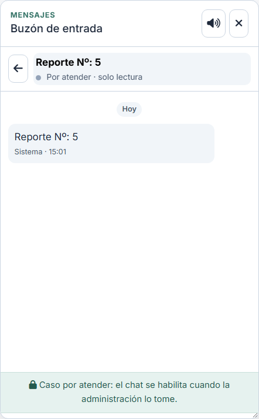
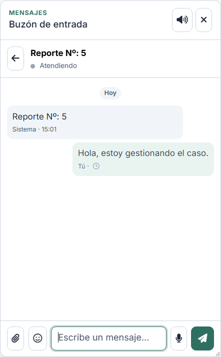
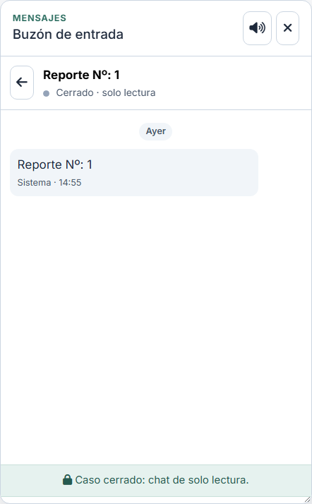

# Chat de reportes: un chat por ticket

Cada reporte (ticket) tiene su propio chat, con tres fases que cambian quién
entra y si se puede escribir.

## Pestaña Reportes

El chat flotante tiene la pestaña **Reportes** con los chats de caso del
usuario:

- El título es **«Reporte Nº: X»** (X es el `id` del reporte).
- El subtítulo indica la fase: «Por atender · solo lectura», «Atendiendo · Nombre»
  o «Cerrado · solo lectura».
- El candado marca los chats que están en solo lectura.

## Fases del chat

| Fase del caso | Quién está en el chat | Escritura |
| --- | --- | --- |
| Por atender | Solo el beneficiario | Solo lectura |
| Atendiendo | Beneficiario y administrador asignado | Ambos escriben |
| Cerrado | Beneficiario y administrador asignado | Solo lectura |

**Por atender** (el caso recién se abre):

**Atendiendo** (el administrador tomó el caso):

**Cerrado**:

El aviso inferior cambia según el caso: «Caso por atender: el chat se habilita
cuando la administración lo tome.», «Caso cerrado: chat de solo lectura.» o
«Chat del evento: solo lectura.» para el canal del evento.

## Reglas

- El chat nace con el ticket, pero **nadie de la administración entra hasta
  tomarlo**. Otro administrador no puede leer ni escribir en el chat de un caso
  que no gestiona, aunque sí ve su ficha en Moderación y puede monitorearlo.
- Un administrador puede tomar **varios casos pendientes**; cada uno tiene su
  chat independiente.
- Al **remitir** el caso a otro administrador, el chat pasa al nuevo gestor y el
  anterior sale; el historial de remisiones (con su observación) queda en la
  ficha del caso.
- Al cerrar el caso, el chat queda en solo lectura para ambos y se conserva como
  historial.
- El botón **Chat del ticket** de Moderación solo aparece para el administrador
  asignado.

## Datos

- `chat_conversations.report_id`: enlace único con `chat_reports`.
- `chat_conversations.type = 'report'` y `name = 'Reporte Nº: X'`.
- `is_read_only`: `1` mientras está por atender y después de cerrarlo; `0` en
  atención.
- `GET /chat/resumen` devuelve `reports` (chats de caso del usuario) y el
  contador del botón flotante los incluye.
