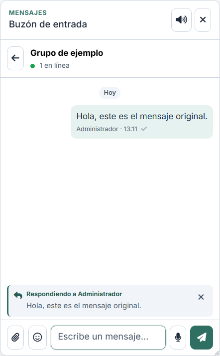
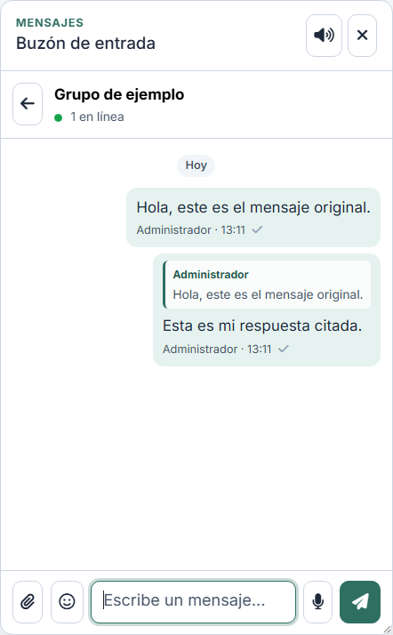
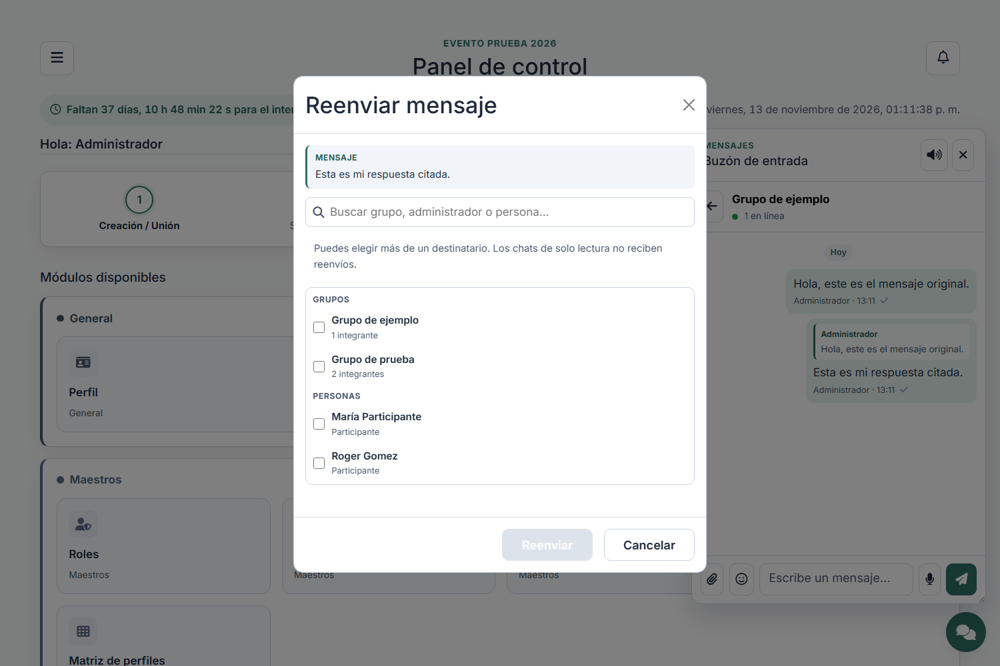

# Responder y reenviar en el chat

Dos acciones nuevas en el menú del clic derecho de cualquier mensaje (chats
directos, grupos, amigo secreto, moderación y salas). El menú las oculta cuando
no aplican (mensaje en envío o eliminado).

## Responder

1. Clic derecho sobre una burbuja → **Responder**.
2. Sobre la barra de escritura se levanta la cita del mensaje original
   (`#chat-reply`). La **X** cancela la respuesta y no se envía nada.

   

3. Al enviar, la burbuja del emisor lleva la cita dentro (remitente y texto
   recortado). Pulsar la cita salta al mensaje original y lo destaca.

   

4. La cita se guarda con el mensaje (`chat_messages.reply_to_id`), así que se ve
   igual al recargar. Si el mensaje citado se elimina, la cita pasa a «Mensaje
   eliminado»; si el usuario había vaciado el chat, la cita no resucita el texto.
5. **Notificación:** una respuesta crea su carga de notificación aunque el
   destinatario haya silenciado la conversación o al remitente. El silencio
   sigue frenando los mensajes normales.

## Reenviar

1. Clic derecho → **Reenviar**. Se abre un modal con la vista previa del mensaje,
   un buscador y los destinos agrupados: **Grupos**, **Administradores**,
   **Amigos secretos** y **Personas**.

   

2. Se pueden marcar varios destinos; el botón indica «Reenviar a N».
3. El mensaje se copia en cada destino (`chat_messages.forwarded_from_id`) y la
   burbuja se marca como **Reenviado**. Los adjuntos se duplican en la carpeta
   del destino: borrar el reenvío no deja sin archivo al original.
4. Las personas se eligen por usuario: si no había chat directo, se crea al
   reenviar. Los bloqueos entre usuarios se respetan.

## Chats de solo lectura

El canal del evento (`chat_conversations.is_read_only`) no permite responder ni
recibir reenvíos:

- sin **Responder** en el menú y sin caja de escritura;
- el canal no aparece como destino del modal y el servidor rechaza el envío
  hacia él (422);
- sí se puede **Reenviar** un mensaje leído en el canal hacia otros chats.

## Datos

- `chat_messages.reply_to_id`: mensaje citado por la respuesta.
- `chat_messages.forwarded_from_id`: mensaje original del reenvío.
- `GET /chat/destinatarios`: grupos, administradores, amigos secretos y personas
  (sin chats de solo lectura ni bloqueados).
- `POST /chat/mensajes/{message}/reenviar`: `conversation_ids[]` y `user_ids[]`.
- `POST /chat/{conversation}/mensajes`: acepta `reply_to_id` opcional.
