# Salas, mensaje fijado, difusión y selección múltiple

Cuatro funciones nuevas del chat. Las salas son grupos cerrados; cada chat
vuelve a tener un solo mensaje fijado; la difusión crea una sala del dueño que
copia cada mensaje en los chats individuales de sus destinatarios; y la
selección múltiple permite responder, guardar, fijar o eliminar varias
burbujas.

## Salas cerradas

Una **sala** es un grupo cerrado: se crea eligiendo personas y no se puede
descubrir ni invitar por enlace. Necesita al menos **tres personas contando al
creador** y no admite vetos ni suspensiones. **Las salas no tienen nombre**: se
identifican únicamente como «Sala» y por las personas que las forman.

1. Abre la pestaña **Salas**.
2. Pulsa **Crear sala**.
3. Marca al menos dos personas y confirma.

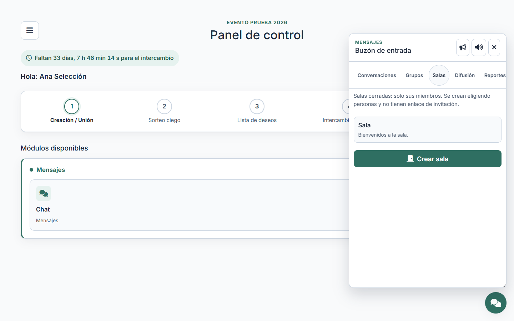

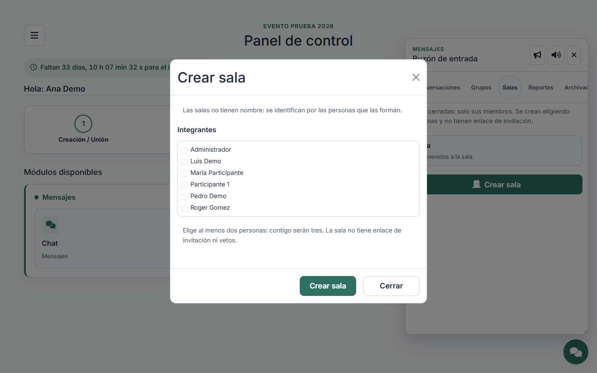

Dentro de la sala el chat funciona como un grupo: remitentes, etiquetas,
adjuntos, encuestas y eventos. El dueño puede **agregar o quitar miembros**
desde el clic derecho sobre la sala → **Gestionar miembros**. Los miembros
normales no pueden cambiar la lista.

- No hay enlace de invitación ni botón de vetados.
- Un usuario que no pertenece a la sala no puede leerla ni buscarla.
- El dueño no puede salir: puede eliminar la sala o quitar miembros.

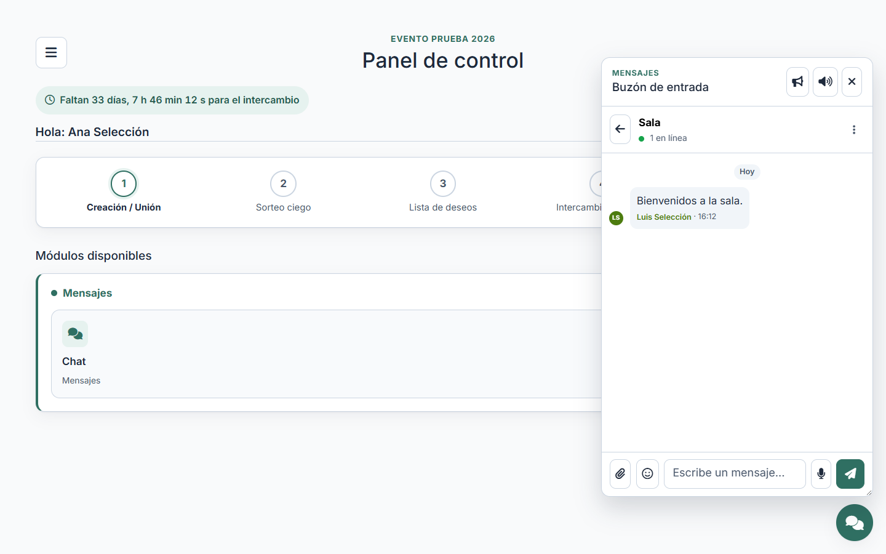

## Un solo mensaje fijado

Cada chat mantiene **un único mensaje fijado**.

- Clic derecho en una burbuja → **Fijar mensaje**. Si ya estaba fijado, el menú
  muestra **Desfijar mensaje**.
- Al fijar otro mensaje, el anterior se suelta automáticamente.
- El cintillo muestra el fijado actual; el clic derecho sobre el cintillo lo
  desfija.
- La burbuja fijada lleva el icono de chincheta.
- También se puede fijar el último mensaje seleccionado desde la barra de
  acciones.

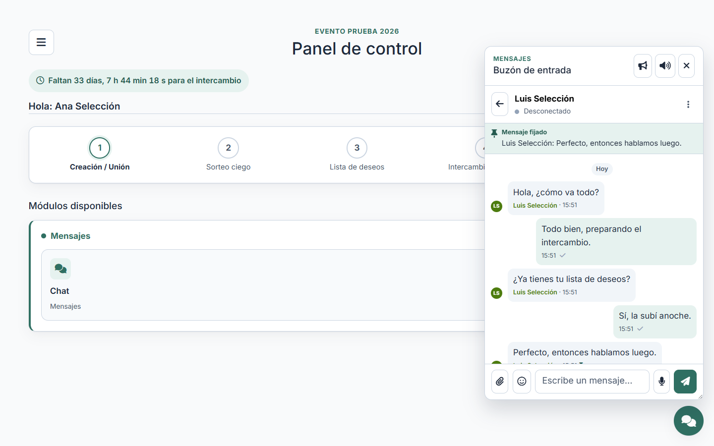

La fuente de verdad es `chat_conversations.pinned_message_id`; cada mensaje
conserva `pinned_at`/`pinned_by` para la marca visual. Una migración limpia
cualquier chat que hubiera quedado con varios fijados de la versión anterior.

## Difusión

La difusión es una **sala del dueño** (`type = broadcast`) con una lista de
destinatarios. Los destinatarios **no son miembros** de la sala: cada mensaje
que el dueño envía en ella se copia en su chat individual con cada uno.

1. Abre la pestaña **Difusión** (o el megáfono de la cabecera).
2. Pulsa **Crear difusión**.
3. Marca una o varias personas (máximo 50) y confirma.

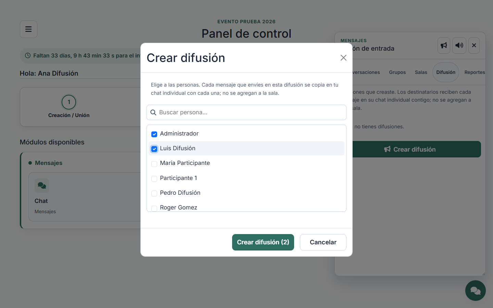

La sala se abre como una conversación normal. Todo lo que se envíe desde su
cuadro de escritura se replica en los chats directos de los destinatarios y
aparece marcado como **Difusión**.

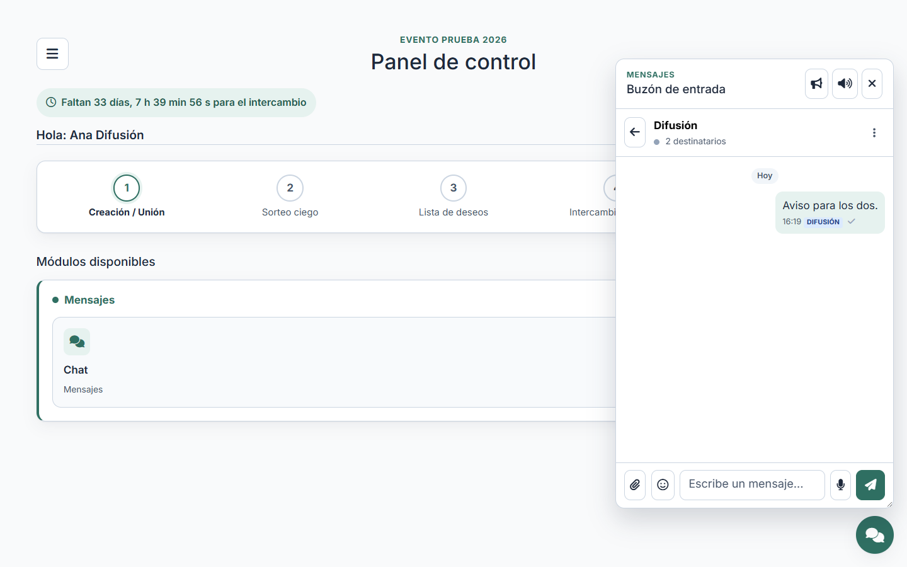

- El **dueño es único**: solo él entra a la sala y puede eliminarla.
- Los destinatarios viven en `chat_broadcast_recipients`; no se agregan a
  `chat_conversation_user`.
- Cada copia se guarda como un mensaje normal en el chat directo, con sus
  propios adjuntos duplicados.
- Se respetan los bloqueos: no se puede crear una difusión con una persona
  bloqueada.
- La lista de difusiones aparece en su pestaña, separada de conversaciones,
  grupos y salas.

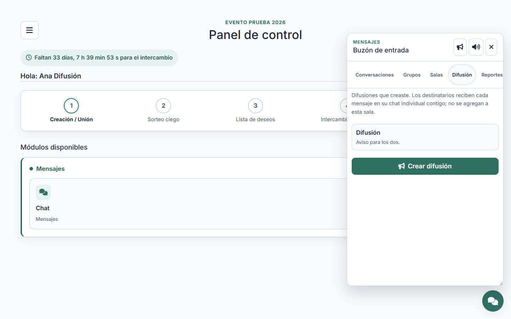

El perfil de la difusión muestra los destinatarios y permite eliminarla.

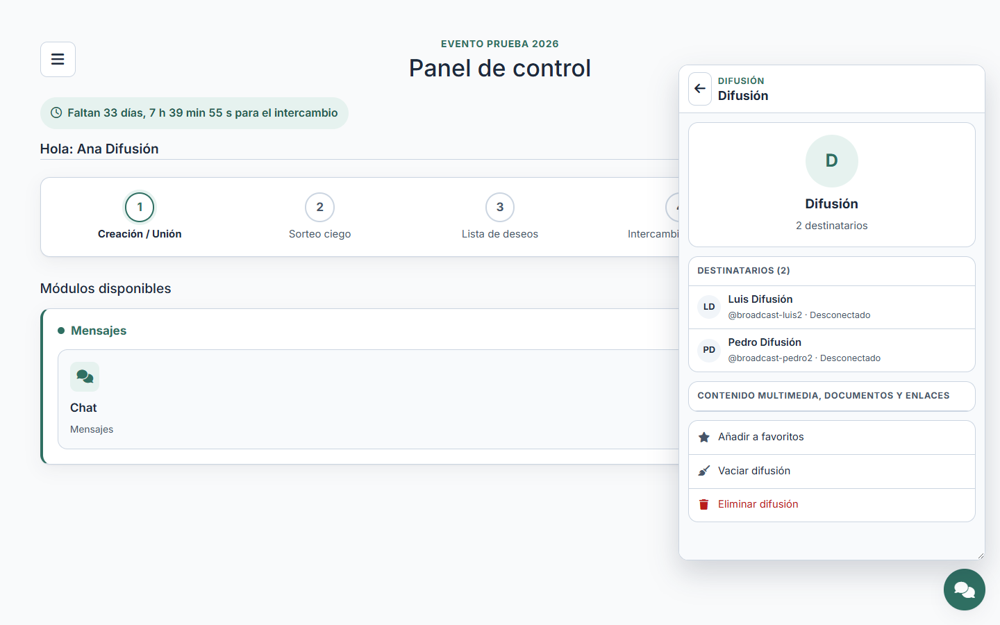

## Selección múltiple

- **Ctrl/Cmd + clic** sobre una burbuja la marca y abre la barra de acciones.
- **Shift + clic** marca el rango entre el ancla y la burbuja pulsada.
- En el menú **⋮** → **Seleccionar mensajes** se entra en modo selección para
  pantallas táctiles; ahí el clic normal alterna cada burbuja.
- La **X** de la barra cancela la selección. También se cierra al cambiar de
  conversación, abrir la búsqueda o cerrar el panel.

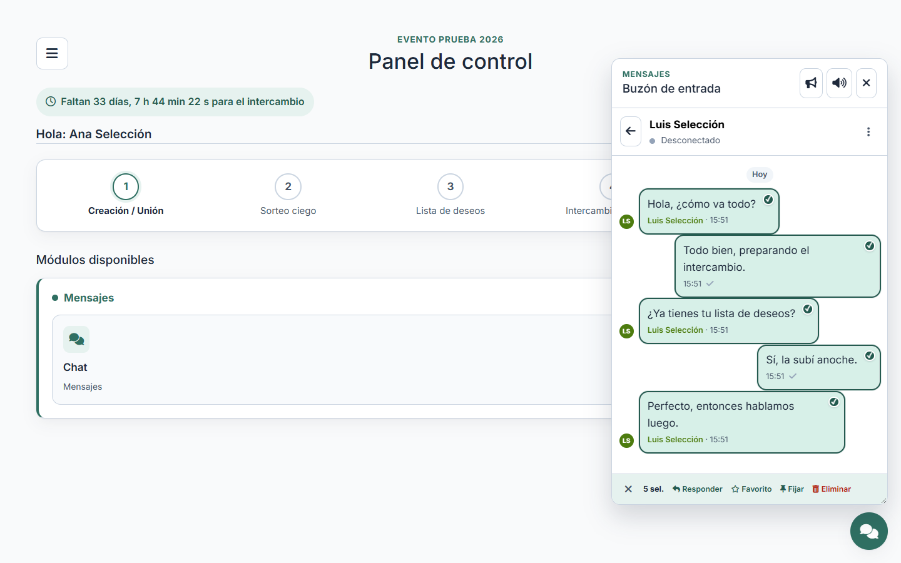

La barra ofrece:

- **Responder**: cita el último mensaje seleccionado.
- **Favorito**: marca o desmarca los mensajes seleccionados como favoritos
  personales. El favorito se ve con una estrella en la burbuja.
- **Fijar**: fija el último mensaje seleccionado; reemplaza el fijado anterior
  porque cada chat tiene un solo mensaje fijado.
- **Eliminar**: borra los mensajes que el usuario puede eliminar. Los mensajes
  de otras personas solo los borra su autor, el dueño del grupo o la
  administración.

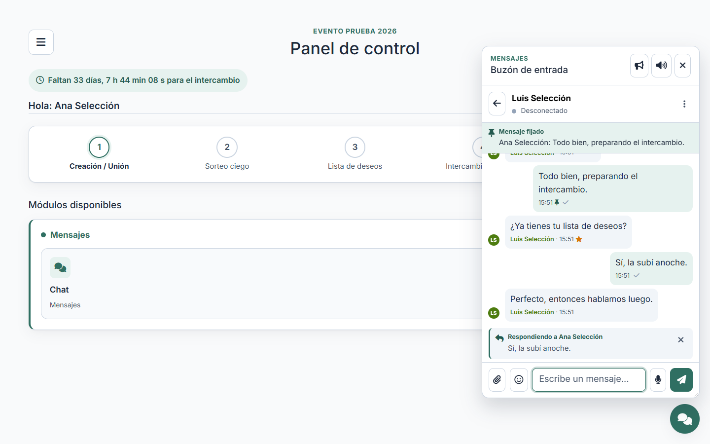

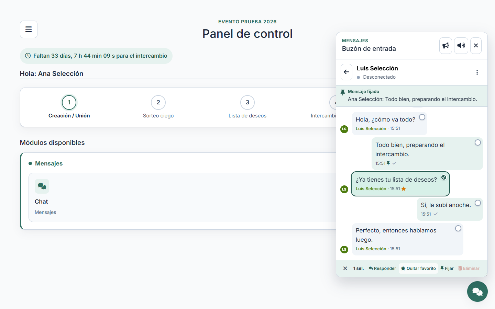

Mientras se selecciona, los clics sobre enlaces, audios o miniaturas no abren
el contenido: seleccionan la burbuja.

## Datos

- `chat_conversations.is_closed`: sala cerrada (grupo sin invitación). Las
  salas se guardan con `name = null`.
- `chat_messages.pinned_at` y `pinned_by`: marca del único mensaje fijado.
- `chat_conversations.pinned_message_id`: el mensaje fijado actual.
- `chat_message_favorites`: favoritos personales por mensaje y usuario.
- `chat_messages.is_broadcast`: mensaje de una sala de difusión y sus copias en
  los chats directos.
- `chat_broadcast_recipients`: destinatarios de cada difusión.
- `POST /chat/sala`: crear sala (`user_ids[]`, mínimo dos personas; no admite
  nombre).
- `POST /chat/sala/{conversation}/miembros`: agregar miembro (dueño o admin).
- `POST /chat/broadcast`: crear sala de difusión (`user_ids[]`).
- `POST /chat/{conversation}/mensajes`: en una sala de difusión, replica el
  mensaje en los chats directos de los destinatarios.
- `POST /chat/{conversation}/fijar-mensaje/{message}`: fijar y reemplazar el
  anterior.
- `DELETE /chat/{conversation}/mensaje-fijado[/{message}]`: desfijar.
- `POST /chat/mensajes/{message}/favorito`: marcar o desmarcar el favorito
  personal (`favorite`: 1/0).
- La selección múltiple reutiliza los endpoints de mensajes, fijado y favorito.

## Pruebas

`tests/Feature/ChatSalasFijadosDifusionTest.php` cubre:

- creación de salas con mínimo de personas y restricciones de invitación/veto;
- acceso solo para miembros y gestión de miembros por el dueño;
- un solo mensaje fijado por chat y reemplazo del anterior;
- eliminación del mensaje fijado;
- favorito personal por usuario;
- creación de la sala de difusión con destinatarios que no entran al chat;
- copia de cada mensaje en los chats directos de los destinatarios;
- rechazo de difusiones con personas bloqueadas;
- presencia de las pestañas, modales y acciones en el widget.
