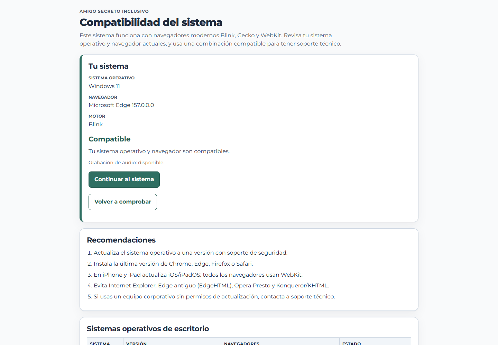
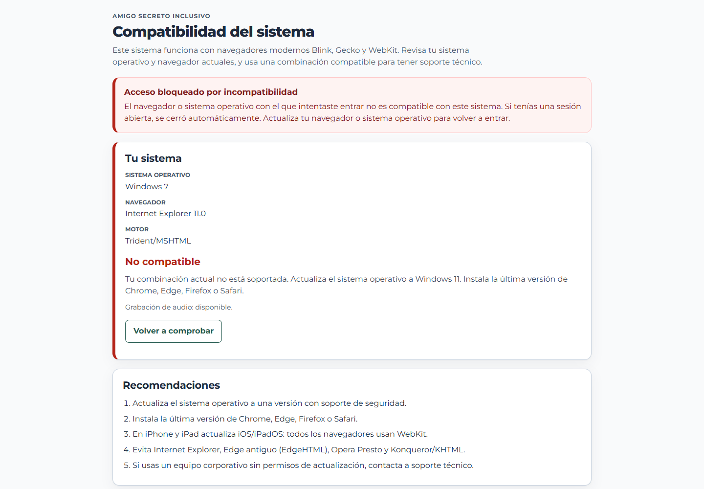
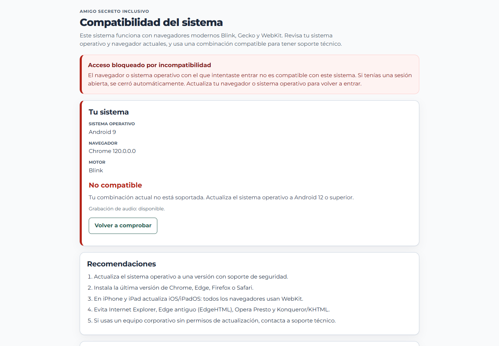

# Compatibilidad de navegadores y sistemas operativos

El sistema detecta el navegador y el sistema operativo al entrar. Si la
combinación no está soportada, muestra la pantalla `/compatibilidad` antes de
cargar el front-end. Si es compatible, la aplicación inicia normalmente.

## Matriz aplicada

### Escritorio

- **Windows 11**: Chrome, Edge o Firefox actuales. Compatible.
- **Windows 10 22H2**: Chrome, Edge o Firefox actuales. Compatible con reservas.
- **Windows 7/8/8.1**: no compatible.
- **macOS 14+**: Safari 17+, Chrome o Firefox actuales. Compatible.
- **macOS 13**: Safari 16/17. Compatible con reservas.
- **macOS 12 o anterior**: no compatible, salvo validación por navegador.
- **Ubuntu 22.04/24.04 LTS, Debian 12, Fedora actual, RHEL 9**: Chrome/Firefox.
- **ChromeOS actual**: compatible.

### Móvil

- **Android 12+**: Chrome, Edge o Samsung Internet actuales. Compatible.
- **Android 10–11**: compatible con reservas.
- **Android 9 o anterior**: no compatible.
- **iOS/iPadOS 17+**: Safari/WebKit. Compatible.
- **iOS/iPadOS 16**: compatible con reservas.
- **iOS/iPadOS 15.8 o anterior**: no compatible.

### Motores

- Blink, Gecko y WebKit modernos: compatibles.
- Trident/MSHTML, EdgeHTML, Presto y KHTML: no compatibles.

## Implementación

- `public/js/browser-support.js`: detección de sistema, navegador, motor y
  capacidades técnicas; genera la recomendación.
- `resources/views/compatibilidad.blade.php`: página informativa, matriz y
  detección del equipo del visitante. Mantiene el lenguaje visual del sistema
  (Montserrat, colores, tarjetas, sombras y botones) sin cargar Bootstrap.
- `app/Http/Middleware/EnsureSupportedBrowser.php`: redirige los motores
  históricos en **cualquier ruta** y cierra la sesión activa antes de mostrar
  la pantalla.
- `layouts/base.blade.php`: puerta de compatibilidad para el resto de casos
  (sistemas operativos o versiones de navegador antiguas). Si hay sesión, usa
  una URL firmada de cierre de sesión antes de continuar.
- `routes/web.php`: ruta pública `/compatibilidad` y cierre firmado
  `/compatibilidad/cerrar-sesion`.
- La pantalla se abre en cualquier punto del sistema, no solo en la raíz o el
  login, y muestra el aviso de que la sesión se cerró por seguridad.

La página de compatibilidad usa HTML/CSS/JS básicos, sin Bootstrap ni variables
CSS, para poder mostrarse también en los navegadores que no pueden ejecutar el
front-end principal. Incluye `theme-color`, `color-scheme` claro y favicon para
respetar la interfaz del navegador.

## Adaptaciones por motor

- **WebKit/Safari:** las notas de voz se guardan con el MIME real del
  `MediaRecorder` (`audio/mp4`/`.m4a` en Safari, `audio/webm` en Chrome/Firefox)
  en lugar de etiquetar todo como WebM. La grabación requiere HTTPS (o
  `localhost`) por la política de medios del navegador.
- **iOS Safari:** los campos de formulario usan 16px en móvil para evitar el
  zoom automático al enfocar; `text-size-adjust` queda al 100%; el chat respeta
  `safe-area-inset-bottom` para no quedar bajo el indicador de inicio.
- **Imágenes:** si Safari no puede generar WebP, se conserva el tipo real
  devuelto por `canvas.toBlob()` (PNG/JPEG) y se ajusta la extensión.
- **WebKit/Safari y navegadores modernos:** los diálogos retiran el foco antes
  de aplicar `aria-hidden`, evitando el bloqueo de accesibilidad de Chrome.
- **Navegación:** `history.replaceState` recibe una cadena, no un objeto `URL`,
  para mantener compatibilidad con WebKit.
- **CSS:** se conservan fallbacks `100vh` para `dvh`; `focus-visible`, `gap`,
  `clamp` y `aspect-ratio` están dentro de las versiones mínimas declaradas.
- **Históricos:** no se usan polyfills para IE/EdgeHTML/Presto/KHTML; esos
  motores ven la pantalla de compatibilidad.

## Verificación

Se probaron los tres motores modernos con Playwright:

- **Blink**: Chrome/Edge.
- **Gecko**: Firefox.
- **WebKit**: WebKit/Safari.

Se validaron inicio de sesión, diálogos Bootbox, carga de DataTables en
Usuarios, apertura del chat y envío de mensajes sin errores de página.

## Recomendación

1. Actualizar el sistema operativo a una versión con soporte.
2. Instalar la última versión de Chrome, Edge, Firefox o Safari.
3. En iOS/iPadOS, actualizar el sistema (todos los navegadores usan WebKit).
4. Evitar IE, Edge antiguo, Opera Presto y Konqueror.
