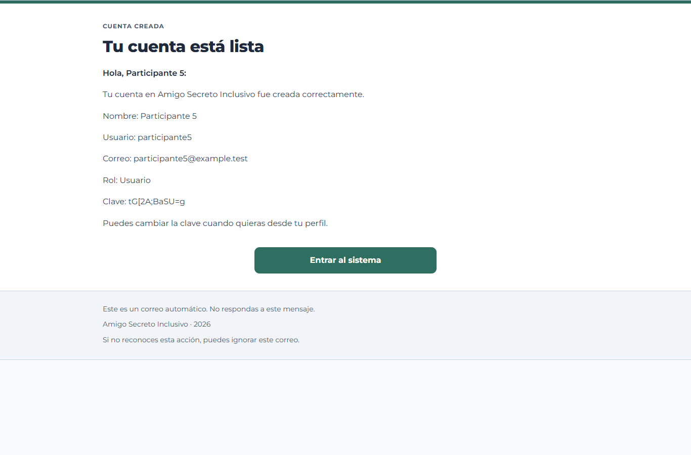
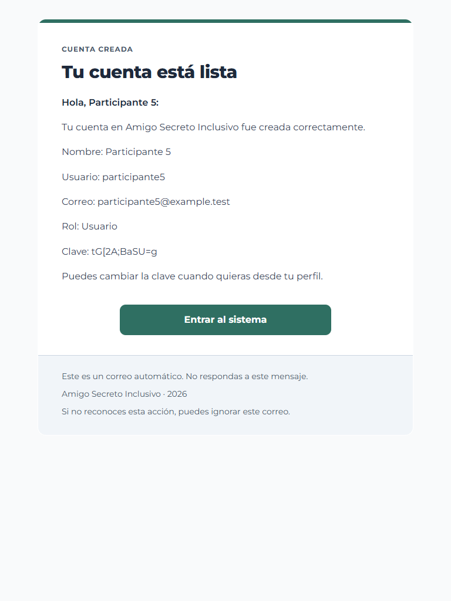
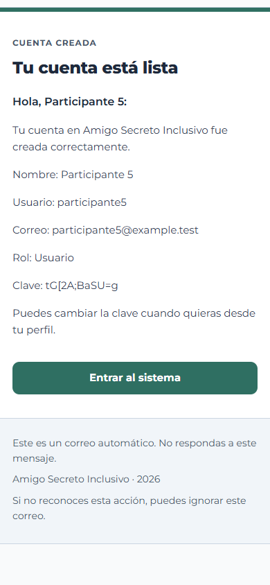
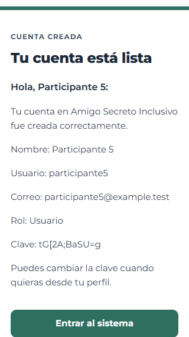
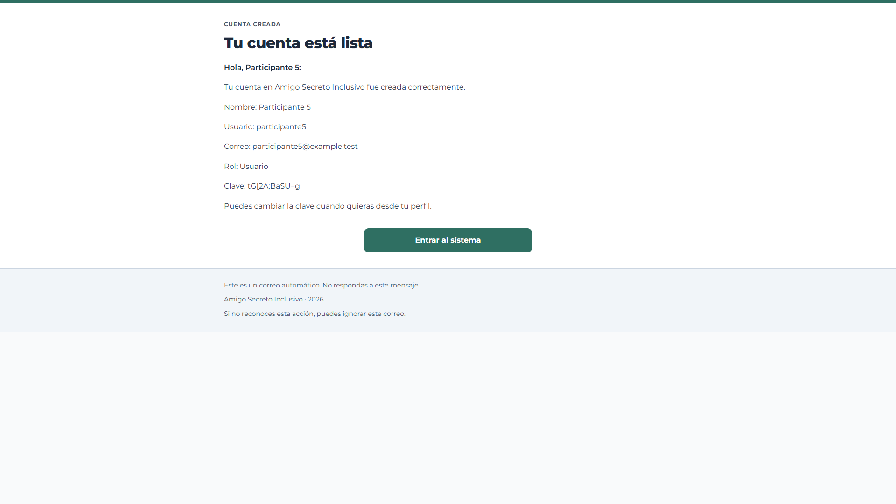

# Plantillas de correo

La plantilla HTML de los correos usa el mismo lenguaje visual del sistema:
Montserrat con respaldo Arial, fondo `#F9FAFB`, tarjetas blancas, borde
`#CBD5E1`, acento verde `#2F6F62`, títulos en peso 800 y botones del sistema.

El diseño usa una tabla fluida:

- pantallas grandes, TV y monitores (≥900px): la tarjeta ocupa el **100%**
  del ancho, sin márgenes laterales;
- el contenido se centra en una columna legible de 960px para evitar líneas
  excesivamente largas;
- tablets: tarjeta de hasta 640px;
- phablets y smartphones: ocupa el 100%, con padding reducido;
- teléfonos pequeños (320–420px): tipografía y botón ajustados, sin desbordes.

## Vistas

## Consideraciones de clientes de correo

- Outlook de escritorio no carga Montserrat: usa Arial mediante estilos MSO.
- Gmail y otros clientes pueden ignorar Google Fonts: el respaldo Arial mantiene
  la legibilidad.
- Los clientes que no soportan `border-radius` muestran la tarjeta rectangular;
  el contenido y la jerarquía visual se mantienen.
- La maquetación usa tablas y estilos inline para máxima compatibilidad.
- No se fuerza el modo oscuro: el correo respeta el diseño claro del sistema.

## Implementación

- `resources/views/emails/notification.blade.php`: versión HTML responsive.
- `resources/views/emails/notification-text.blade.php`: versión de texto.
- `app/Services/MailNotifier.php`: evita duplicar el saludo «Hola, Nombre:».
- `tests/Feature/MailHelperTest.php`: prueba de render, tipografía y saludo único.
