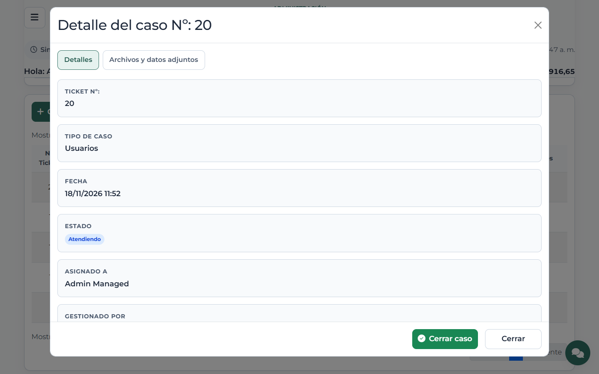

# Casos gestionados: ya no se remiten

Cuando un caso ya fue gestionado, no tiene sentido remitirlo a otro
administrador. El caso queda listo para cerrarse.

Se considera gestionado cuando:

- se creó el usuario de una solicitud de registro (o el usuario ya existe);
- se restableció o desbloqueó la contraseña desde Usuarios;
- se respondió una sugerencia;
- se realizó una acción de moderación sobre el chat del caso;
- el caso se cerró.

En esos casos:

- **Remitir caso** desaparece de la ficha;
- la API de remisión responde que el caso ya tuvo una gestión efectiva;
- solo queda **Cerrar caso**.

## Implementación

- `ChatReport::isManaged()` tiene en cuenta `managed_at` y, para solicitudes de
  registro, la existencia del usuario con el correo o nombre de usuario del
  caso.
- `ModeracionController::rowData()` expone `is_managed` y calcula
  `can_refer` solo para casos no gestionados.
- `moderacion.js` oculta **Remitir caso** cuando `can_refer` es falso.
- La ruta de remisión rechaza casos gestionados.
