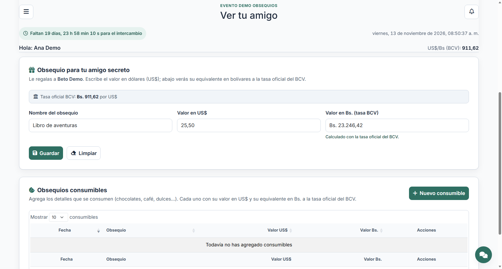
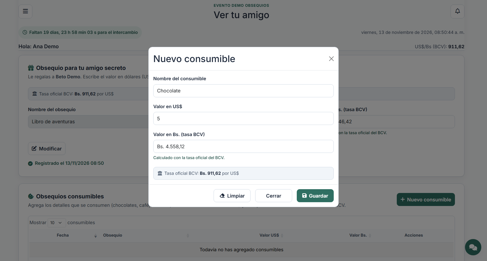
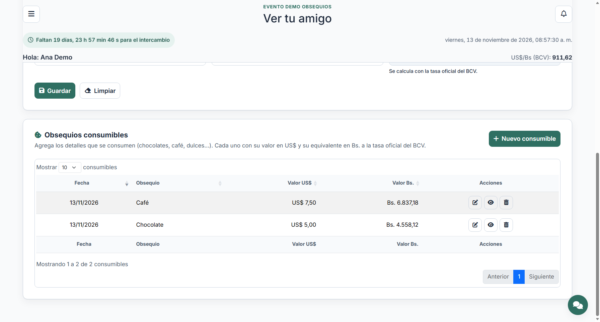

# Obsequios de «Ver tu amigo»

Dos secciones nuevas en la página **Ver tu amigo**, después de la tarjeta del
amigo secreto:

1. **Obsequio para tu amigo secreto**: el regalo único, con su valor en US$ y
   el equivalente en Bs. a la tasa oficial del BCV.
2. **Obsequios consumibles**: una tabla paginada con los detalles que se
   consumen, con agregar, modificar, ver y eliminar.

Solo se activan cuando el sorteo ya concluyó y el evento avanzó a la etapa de
obsequios (estado **sorteado**). Mientras el sorteo esté abierto se muestra un
aviso; cuando el evento termina, todo queda en solo lectura.



## Conversión a bolívares

- Todos los montos se guardan en **USD**; los bolívares son solo presentación.
- La tasa se consulta con `dollar_rate()` (API del BCV con caché corta y, si
  falla, la última tasa guardada en `exchange_rates`).
- El valor en Bs. se actualiza **por AJAX** al escribir el monto y siempre es
  de solo lectura. Si no hay tasa disponible se muestra `—` y un aviso.
- Formato venezolano: `US$ 25,50` y `Bs. 23.246,42`.

## Sección del obsequio

- Campos: **nombre** y **valor en US$**. El valor en Bs. se calcula aparte.
- Sin obsequio registrado: botones **Guardar** y **Limpiar**. Limpiar restablece
  el formulario; guardar pide confirmación («¿Desea registrar el obsequio?»).
- Al guardar correctamente el formulario queda **deshabilitado (solo lectura)**,
  con la fecha de registro y el botón **Modificar**.
- Con un obsequio registrado, **Modificar** habilita los campos y muestra
  **Guardar**, **Limpiar** y **Cancelar**. Cancelar restaura los valores
  guardados; guardar confirma («¿Desea modificar el obsequio?»).
- Los errores y el resultado se muestran por AJAX junto al formulario; si el
  evento define un valor mínimo o máximo, se valida y se explica el tope.

## Sección de consumibles

- **Nuevo consumible** abre un modal con **nombre**, **valor en US$** y el
  **valor en Bs.** de solo lectura (también por AJAX).
- Botones del modal: **Guardar**, **Limpiar** y **Cerrar**. Cerrar cierra el
  modal y limpia el formulario; Limpiar solo limpia los campos. Guardar pide
  confirmación («¿Desea agregar el consumible?») y, si se confirma, guarda por
  AJAX y muestra el mensaje; si falla, el modal sigue abierto con el error.
- La tabla se pagina en el servidor y muestra: Fecha, Obsequio, Valor US$,
  Valor Bs. y Acciones.
- Acciones por fila:
  - **Modificar**: abre el mismo modal con los datos cargados y pide
    confirmación al guardar.
  - **Ver**: ficha del consumible en un modal de solo lectura.
  - **Eliminar**: pide confirmación («¿Desea eliminar «…»?») y elimina por AJAX.
- Si el evento tiene tope de consumibles, se valida el total y se indica cuánto
  queda disponible.





## Base de datos y modelos

Las tablas ya existían y se usan tal cual:

- `exchange_gifts` (migración `2026_11_09_000004`): `assignment_id`, `product`,
  `value`, `registered_at`. Un solo regalo por pareja (índice único).
- `consumable_gifts` (migración `2026_11_09_000005`): `assignment_id`,
  `description`, `quantity`, `value`, `given_on`.

Modelos: `Assignment` (relaciones `exchangeGift` y `consumableGifts`),
`ExchangeGift` y `ConsumableGift`. El formulario pide nombre y valor; la
cantidad se guarda en 1 y la fecha del consumible es la del día del registro.
No hizo falta una migración nueva: el esquema ya cubría estos datos.

## Endpoints

| Método | Ruta | Para qué |
| --- | --- | --- |
| GET | `/amigo-secreto/ver-tu-amigo/tasa?valor=` | Convierte US$ a Bs. con la tasa BCV. |
| POST | `/amigo-secreto/ver-tu-amigo/obsequio` | Registra el obsequio único. |
| PUT | `/amigo-secreto/ver-tu-amigo/obsequio` | Modifica el obsequio registrado. |
| GET | `/amigo-secreto/ver-tu-amigo/consumibles/datos` | DataTable paginado de consumibles. |
| POST | `/amigo-secreto/ver-tu-amigo/consumibles` | Agrega un consumible. |
| GET | `/amigo-secreto/ver-tu-amigo/consumibles/{id}` | Ficha del consumible (modal Ver y datos para Modificar). |
| PUT | `/amigo-secreto/ver-tu-amigo/consumibles/{id}` | Modifica un consumible propio. |
| DELETE | `/amigo-secreto/ver-tu-amigo/consumibles/{id}` | Elimina un consumible propio. |

Todas exigen sesión y el módulo **Ver tu amigo**. Cada acción comprueba también
que el usuario tenga amigo secreto descubierto, que el evento esté en la etapa
de obsequios y que el consumible pertenezca a su propia asignación.

## Piezas

- `app/Http/Controllers/ObsequiosAmigoController.php`: tasa, obsequio y CRUD de
  consumibles.
- `app/Http/Controllers/VerTuAmigoController.php`: calcula si las secciones se
  muestran, si se puede editar y pasa el obsequio y la tasa a la vista.
- `app/Helpers/general.php`: `dollar_rate()`.
- `resources/views/amigo/partials/`: `obsequio`, `consumibles`,
  `consumible-acciones`, `consumible-ficha` y los dos modales.
- `public/js/ver-tu-amigo.js`: estados del formulario, tasa por AJAX, DataTable
  y modales.
- `public/css/style.css` (sección «Obsequios de Ver tu amigo»).
- `tests/Feature/ObsequiosAmigoTest.php`: activación por etapa, tasa, registro y
  modificación, validaciones y topes, CRUD de consumibles, propiedad y solo
  lectura al terminar el evento.

## Pruebas

```bash
php artisan test --filter=ObsequiosAmigoTest
```

La suite completa (`php artisan test`) cubre además el sorteo, «Ver tu amigo» y
el monitoreo de participantes.
