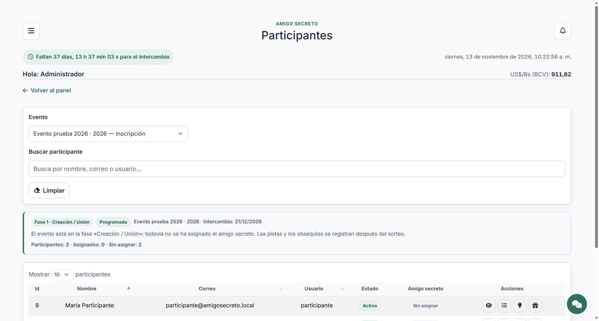
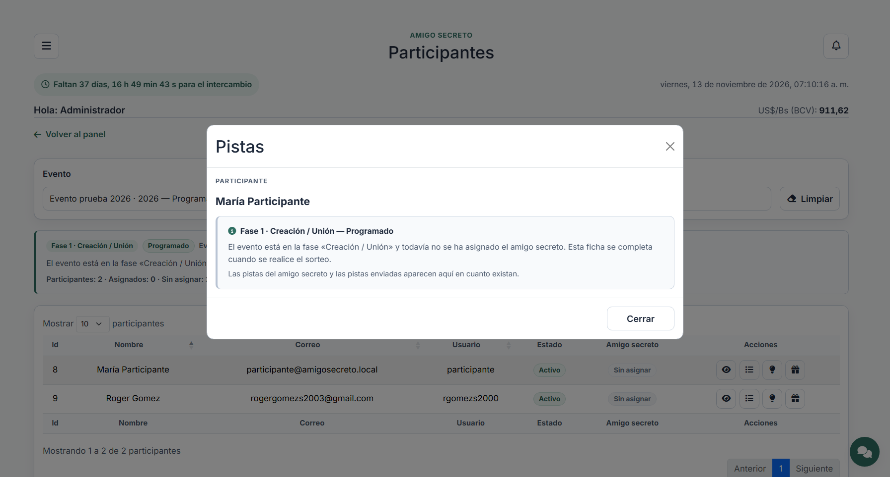

# Participantes: monitoreo del evento

Módulo de **solo lectura** para la administración. No inscribe, no modifica y no
borra nada: consulta el evento elegido y abre la ficha de cada participante en
un modal. La tabla principal y las tablas de las fichas se paginan en el
servidor.

## Acceso y orden

- Código interno del módulo: `participantes` (categoría Amigo secreto).
- Se activa con el permiso **Ver** del perfil Administrador. Además del acceso
  por matriz, las acciones comprueban que la cuenta tenga rol de administración:
  la lista de deseos incluye restricciones alimentarias y las pistas son
  anónimas.
- Orden dentro de la categoría: **Participantes (75)**, **Usuarios asociados
  (76)** y después **Lista de deseos (80)**. Los dos módulos de monitoreo van
  delante de la lista de deseos, como se pidió.
- La migración `2026_11_15_000001_activate_participantes_module.php` deja el
  orden y la concesión al Administrador en bases existentes; `ModuleSeeder` y
  `AccessSeeder` lo replican en instalaciones nuevas.

## Página (`/amigo-secreto/participantes`)

- **Combo de evento**: muestra todos los eventos; por defecto abre el evento
  actual y en curso (el más reciente que no terminó ni está suspendido; si ya
  terminaron todos, el más reciente). Al cambiarlo se recarga la tabla.
- **Buscar participante**: única barra de búsqueda (nombre, correo o usuario).
  No hay criterios de filtro.
- **Limpiar**: vacía la búsqueda y devuelve la consulta al evento actual.
- **Aviso de fase**: indica la fase del flujo, el estado del evento, la fecha
  del intercambio y cuántos participantes están asignados y sin asignar.
- **Tabla**: Id, Nombre, Correo, Usuario, Estado (participación y cuenta),
  Amigo secreto (Sin asignar / Asignado / Visto) y las cuatro acciones.



## Fichas en modal

| Acción | Contenido |
| --- | --- |
| Ver | Ficha del participante: ID, usuario, correo, teléfono, rol, cuenta, participación, amigo secreto, confirmado, alta y observaciones del evento. |
| Lista de deseos | Deseos, restricciones a evitar, categorías y fecha de actualización. |
| Pistas | Dos pestañas paginadas: **Pistas del amigo secreto** (las que recibe) y **Pistas al amigo secreto** (las que envía, con el destinatario). |
| Obsequios | Sección del **obsequio** (producto, valor y fecha) y, debajo, los **obsequios consumibles** paginados (fecha, obsequio, cantidad y valor) con cantidad y valor total. |

Las pistas recibidas nunca muestran quién las escribió: el anonimato del amigo
secreto se mantiene también para la administración.



## Fases y avisos

La fase se calcula con `App\Support\FaseEvento` (la misma que usa el panel):

1. **Creación / Unión**: todavía no hay amigo secreto. Las fichas de pistas y
   obsequios muestran el aviso de fase en vez de sus tablas.
2. **Sorteo ciego**: si el participante aún no tiene amigo secreto asignado, el
   aviso lo dice y las tablas quedan ocultas; si ya lo tiene, las tablas se
   muestran (vacías hasta que existan datos).
3. **Lista de deseos**, **Intercambio de pistas** y **Gran revelación**: se
   muestra lo registrado, según el caso.
4. Evento **suspendido**: se indica y la información queda en solo lectura.

## Endpoints

Todas las rutas exigen sesión; las consultas de fichas reciben `evento` como
parámetro y validan que el usuario participe en ese evento.

| Método | Ruta | Para qué |
| --- | --- | --- |
| GET | `/participantes/datos` | DataTable de participantes del evento. |
| GET | `/participantes/{participant}/ficha` | Ficha en HTML + estado del amigo secreto. |
| GET | `/participantes/{participant}/lista-deseos` | Ficha de la lista de deseos. |
| GET | `/participantes/{participant}/pistas` | DataTable de pistas (`tipo=recibidas|enviadas`). |
| GET | `/participantes/{participant}/obsequios` | Obsequio único + totales. |
| GET | `/participantes/{participant}/obsequios/consumibles` | DataTable de consumibles + totales. |

## Piezas

- `app/Http/Controllers/ParticipantesController.php`: consultas y respuestas.
- `app/Support/FaseEvento.php`: fase del flujo a partir del estado del evento.
- `app/Support/ModulePages.php`: asocia el código `participantes` al controlador.
- `routes/web.php`: tabla y fichas (la página la sirve el enrutador de módulos).
- `resources/views/participantes/`: página, avisos, acciones y modales.
- `public/js/participantes.js`: DataTables, búsqueda, limpiar y modales.
- `public/css/style.css` (sección «Participantes»): estilos del módulo.
- `database/migrations/2026_11_15_000001_activate_participantes_module.php`:
  orden de módulos y concesión al Administrador.
- `tests/Feature/ParticipantesTest.php`: acceso, datos, búsqueda, fichas,
  pistas, obsequios, paginación, fases y orden de los módulos.

## Pruebas

```bash
php artisan test --filter=ParticipantesTest
```

La suite completa (`php artisan test`) incluye además las pruebas de eventos,
sorteo y del panel, que comparten `FaseEvento`.
