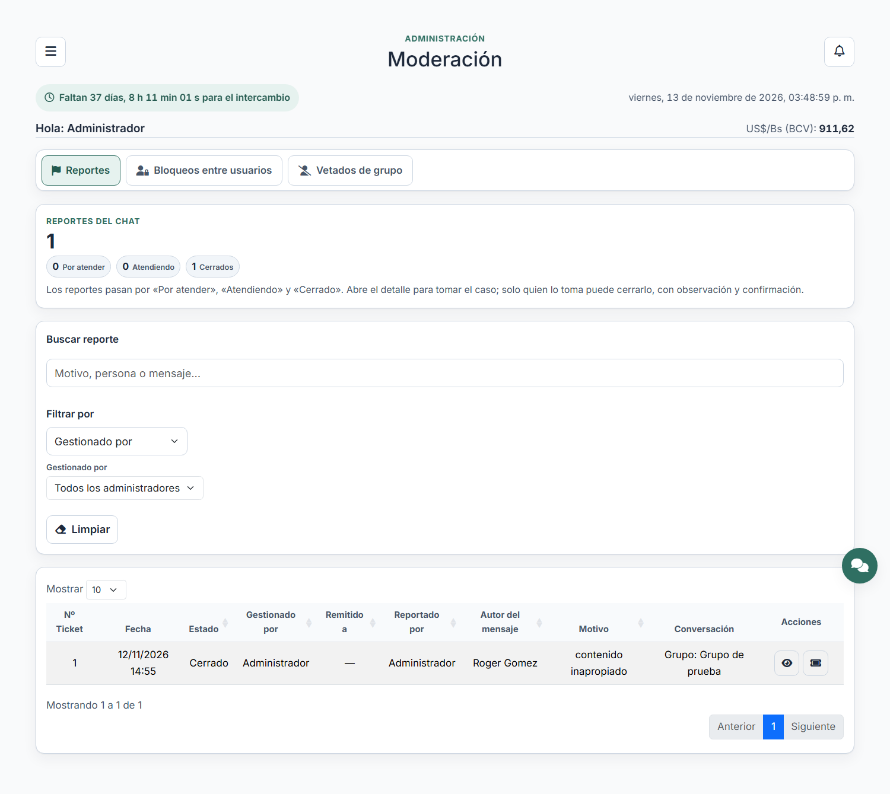

# Flujo de casos de reportes

Los reportes del chat tienen tres estados:

1. **Por atender**: se crea cuando un usuario reporta un mensaje, a una persona o
   una conversación/grupo. El caso abre su **chat en solo lectura**, visible solo
   para el **beneficiario** (quien reportó). El beneficiario recibe correo y push
   de apertura; la administración recibe un push.
2. **Atendiendo**: un administrador abre el detalle y pulsa **Tomar caso**.
   Queda asociado a ese administrador, **entra al chat del caso** y la escritura
   se habilita para los dos. El administrador recibe el **correo del caso para
   gestionarlo** y el beneficiario el aviso de la nueva fase.
3. **Cerrado**: solo el administrador que tomó el caso puede cerrarlo, con una
   observación de cierre obligatoria y confirmación expresa. El **chat del caso
   vuelve a solo lectura** para ambos y el beneficiario recibe el correo y push
   de cierre.

## Tomar el caso

En el detalle del reporte, el botón **Tomar caso** abre un formulario con una
observación opcional. Al confirmar:

- se guarda `assigned_to`, `taken_at` y `attention_observation`;
- el estado pasa a **Atendiendo**;
- los demás administradores ya no pueden tomarlo ni cerrarlo (pero sí ver la
  ficha y monitorearlo);
- el administrador entra al chat del caso y el chat se abre en el chat flotante;
- el administrador recibe el correo del caso y el beneficiario el aviso de fase.

Un administrador puede tomar **tantos casos pendientes como quiera**; cada uno
con su propio chat.

## Cerrar el caso

El botón **Cerrar caso** solo aparece para el administrador asignado. El modal
pide:

- observación de cierre (obligatoria);
- confirmación «Confirmo que el reporte quedó cerrado».

Si se marca la confirmación y se pulsa **Sí, cerrar caso**, se guarda
`closed_at`, `closed_by` y `close_observation`, el estado pasa a **Cerrado** y el
chat del caso pasa a **solo lectura** (sin caja de escritura) para ambos. El
beneficiario recibe el correo y push de cierre.

El servidor vuelve a comprobar que el usuario sea el asignado, que el caso siga
en atención y que la confirmación y la observación estén presentes.

## Lista y filtros

La tabla de Moderación muestra, por cada ticket: **Nº Ticket**, fecha, estado,
**Gestionado por**, **Remitido a**, reportado por, autor del mensaje, motivo,
conversación y acciones.

- **Gestionado por**: administrador que tomó y gestionó el caso **originalmente**,
  aunque después lo haya remitido.
- **Remitido a**: último administrador al que se remitió el caso; «—» si nunca
  se remitió.

En **Filtrar por** hay ahora dos criterios más, cada uno con su combobox de
administradores:

- **Gestionado por**: deja los casos que ese administrador tomó originalmente.
- **Remitido a**: deja los casos remitidos a ese administrador (último destino).

## Remitir el caso

El administrador que gestiona un caso (estado **Atendiendo**) puede remitirlo a
otro administrador. En el detalle, el botón **Remitir caso** abre un modal con:

- un **combobox con autocompletado** para buscar al administrador de destino
  (solo administradores activos; nunca el propio gestor ni el beneficiario);
- un campo de texto para la **observación**, obligatoria, con el motivo de la
  remisión.

Al confirmar:

- se guarda la remisión con quién la hizo, a quién y su observación; queda en el
  historial visible en el detalle del caso;
- el caso cambia de administrador asignado y el **chat del ticket pasa al nuevo
  gestor**; el anterior deja de gestionarlo y de tener acceso al chat;
- el nuevo gestor recibe el correo del caso con la observación de la remisión y
  el beneficiario recibe el aviso del cambio de gestor;
- el gestor anterior no puede cerrar ni volver a remitir el caso: solo podrá
  recuperarlo si el nuevo gestor se lo remite de vuelta.

Un administrador puede gestionar **varios casos a la vez**; la remisión afecta
solo al caso elegido.

## Chat del caso (ticket)

- Hay **un chat por reporte**, enlazado con `chat_conversations.report_id`.
- Nace al abrir el caso y se identifica con el número de ticket: el título y el
  primer mensaje son «Reporte Nº: X».
- Mientras el caso está **por atender**: solo está el beneficiario y el chat es
  de **solo lectura**.
- Al **tomarlo**: el administrador entra al chat y se habilita la escritura para
  el beneficiario y el gestor.
- Al **cerrarlo**: el chat queda en solo lectura para los dos y se conserva como
  historial.
- Ningún otro usuario ni administrador entra al chat; los demás administradores
  solo ven la ficha del caso en Moderación.
- Vive en la pestaña **Reportes** del chat flotante; desde Moderación también se
  abre con el botón **Chat del ticket** (solo el administrador asignado).

## Rutas

- `POST /moderacion/reportes/{report}/tomar`
- `POST /moderacion/reportes/{report}/cerrar`
- `GET /chat/resumen` devuelve `reports` con los chats de caso del usuario.

La lista muestra el estado y el detalle muestra asignación, fechas y ambas
observaciones; el chat del caso se enlaza desde la tabla y el detalle para el
administrador asignado.
