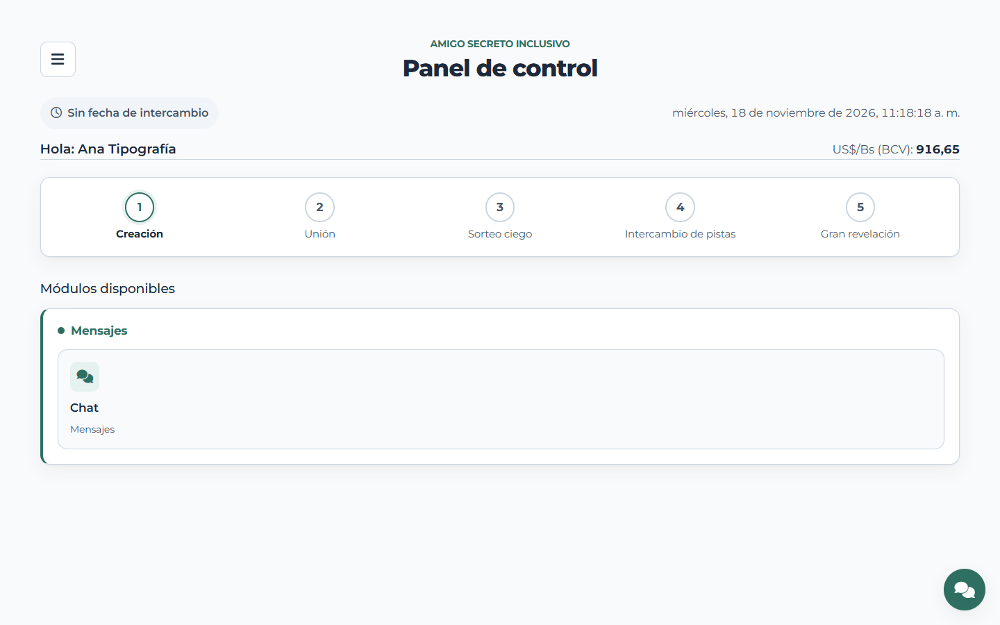
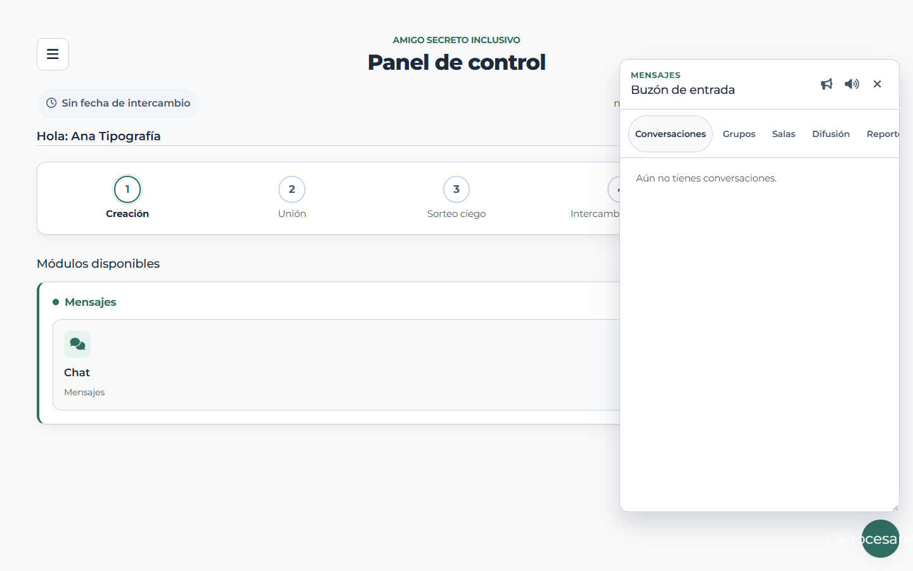

# Tipografía del sistema

El sistema usa **Montserrat** como tipografía principal y **Arial** como
respaldo. Montserrat se carga desde Google Fonts con los pesos 400, 500, 600,
700 y 800.

- Texto general, formularios, tablas y chat: Montserrat.
- Títulos, botones, pestañas y etiquetas: Montserrat con tracking ligeramente
  cerrado.
- `Panel de control`: Montserrat 800.
- Si Montserrat no carga, todo sigue funcionando con Arial y el resto de la
  pila del sistema.

## Implementación

- [base.blade.php](../resources/views/layouts/base.blade.php): carga de
  Montserrat con peso 800.
- [style.css](../public/css/style.css): `--font-sans` y `--font-display` con
  Montserrat primero; variables de Bootstrap para que los controles hereden la
  fuente; ajuste de tracking y peso del título principal.
