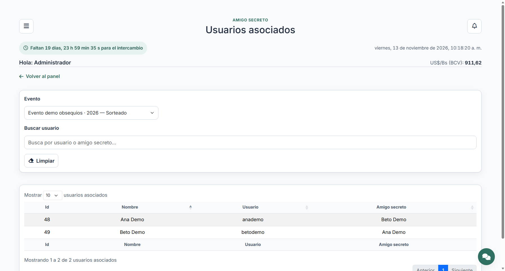

# Usuarios asociados: consulta de parejas

Módulo de **solo lectura** para la administración. Muestra, por evento, cada
usuario con el amigo secreto que le fue asignado: quién regala a quién. No abre
fichas, no muestra listas de deseos ni obsequios y no modifica nada.

## Formulario

Igual que **Participantes**, en una sola columna:

1. **Evento**: por defecto el actual y en curso; el selector lista todos los
   eventos, también los históricos.
2. **Buscar usuario**: filtra por el usuario (nombre, correo o usuario de
   acceso) o por el nombre del amigo secreto.
3. **Limpiar**: vacía la búsqueda y devuelve la consulta al evento actual.

## Tabla

DataTable paginada en el servidor, de solo lectura, con cuatro columnas:

| Columna | Contenido |
| --- | --- |
| Id | Id del usuario (quien regala). |
| Nombre | Nombre del usuario. |
| Usuario | Nombre de acceso del usuario. |
| Amigo secreto | Nombre del amigo secreto asignado. |

Si el evento todavía no tiene sorteo, la tabla lo indica («Las parejas aparecen
cuando se realiza el sorteo»).



## Apertura y cierre por evento

- El módulo se activa cuando existe al menos un evento. Sin eventos, la página
  explica cómo crearlo.
- Consulta por defecto el evento actual y en curso.
- Los eventos terminados se consultan en modo histórico: la página muestra el
  aviso «El evento terminó: esta consulta es histórica y de solo lectura» y los
  datos se mantienen disponibles.
- Si el evento está suspendido se avisa y la consulta también es de solo
  lectura.

## Endpoint

| Método | Ruta | Para qué |
| --- | --- | --- |
| GET | `/usuarios-asociados/datos` | DataTable de parejas del evento (`evento` como parámetro). |

Exige sesión, el módulo **Usuarios asociados** concedido y rol de
administración. La página la sirve el enrutador de módulos en
`/amigo-secreto/usuarios-asociados`.

## Piezas

- `app/Http/Controllers/UsuariosAsociadosController.php`: consulta y DataTable.
- `app/Http/Controllers/Concerns/ResuelveEventoConsulta.php`: evento actual y
  evento elegido, compartido con Participantes.
- `app/Support/ModulePages.php`: asocia el módulo a su controlador.
- `resources/views/usuarios-asociados/`: página y aviso de histórico.
- `public/js/usuarios-asociados.js`: DataTable, búsqueda, evento y limpiar.
- `database/migrations/2026_11_15_000002_activate_usuarios_asociados_module.php`:
  orden (76) y acceso del perfil Administrador.
- `tests/Feature/UsuariosAsociadosTest.php`: acceso, eventos, búsqueda,
  paginación, histórico y cierre.

## Pruebas

```bash
php artisan test --filter=UsuariosAsociadosTest
```
