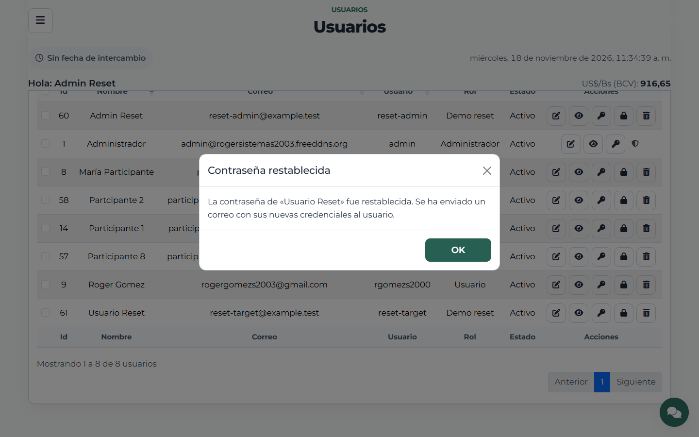
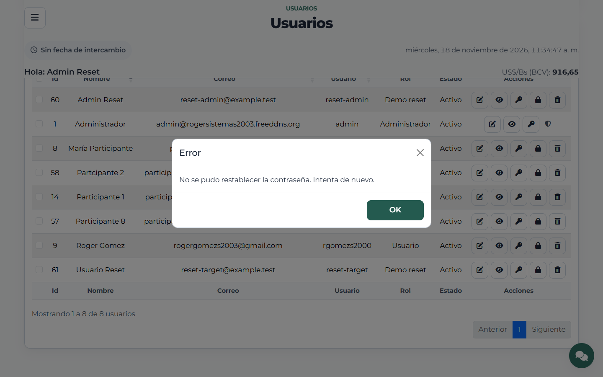
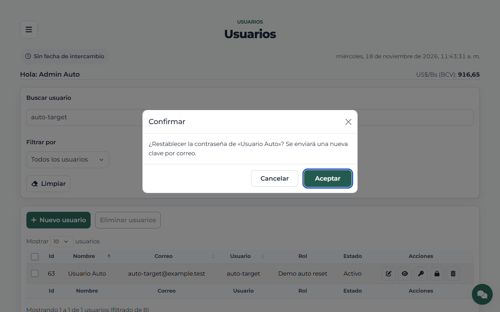
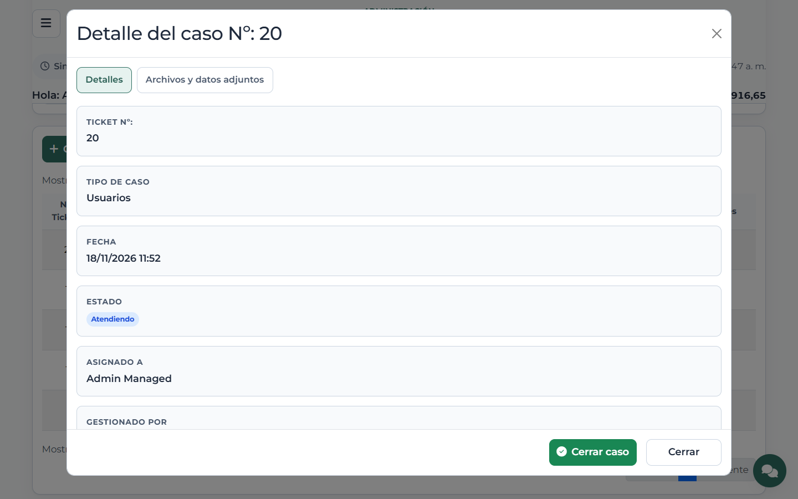

# Restablecer contraseña de un usuario

Cuando la administración pulsa **Aceptar** en la confirmación de restablecer
contraseña:

1. Se procesa el cambio.
2. Si la contraseña se cambió y el correo se envió, aparece:

   > **Contraseña restablecida**
   > La contraseña de «Usuario» fue restablecida. Se ha enviado un correo con
   > sus nuevas credenciales al usuario.

3. Si la contraseña se cambió pero el correo falló, aparece un aviso con el
   error de correo para que se revise la configuración.
4. Si el proceso falla, aparece un diálogo **Error** con el mensaje devuelto por
   el servidor.

El mensaje de éxito se muestra antes de recargar la lista. El error no recarga
la página, para que se pueda reintentar.

## Desde un caso de soporte

El botón **Cambio de contraseña del usuario** de un caso lleva al módulo
**Usuarios** con el usuario ya buscado y abre automáticamente la confirmación
para restablecer la contraseña.

Una vez restablecida, el caso queda marcado como gestionado y la acción de
contraseña desaparece de la ficha. El caso queda únicamente para **Cerrar caso**.
Si se intenta restablecer de nuevo desde la API, responde que el caso ya fue
gestionado y solo queda cerrarlo.

## Implementación

- `POST /usuarios/{user}/restablecer` devuelve `message` y `mail_sent`.
- El mensaje de éxito incluye el nombre del usuario y confirma el correo.
- El frontend usa `AppDialog.success`, `AppDialog.warning` o `AppDialog.error`
  según el resultado.
- El enlace del caso contiene `buscar=...&restablecer=ID`; la página de Usuarios
  dispara la misma confirmación del botón y limpia el parámetro de la URL.
- El detalle del caso expone `is_managed` y deja de enviar
  `password_change_url` después de la gestión.
